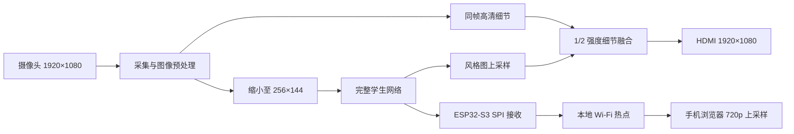
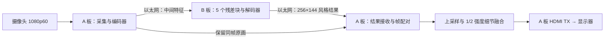

# Ti60 实时艺术风格相机

在 FPGA 上，把摄像头的实时画面转换成梵高、浮世绘和水墨三种艺术风格，并通过 HDMI 显示。

本项目面向全国大学生嵌入式芯片与系统设计竞赛 FPGA 创新设计赛道，以 Ti60F225 为核心，完成从模型蒸馏、定点部署、神经网络加速到视频采集、高清显示和本地无线交互的完整设计。提供 **单板 1080p30** 和 **双板以太网 1080p60** 两条实现路线。

**1080p 指采集与 HDMI 显示分辨率；神经网络的实际输入、输出均为 256×144。** HDMI 画面通过上采样及同帧原始高清细节补充得到。手机支路接收 256×144 风格图，在浏览器放大至 1280×720，不执行神经网络，也不融合高清原图。

## 能做什么

| 功能 | 单板方案 | 双板以太网方案 |
|---|---|---|
| 风格画面 | 梵高、浮世绘、水墨，约 30 张新结果/秒 | 三风格计算架构；已有约 60 张新结果/秒的保存运行窗口 |
| HDMI 输出 | 1920×1080，约 30 Hz 扫描 | 1920×1080，约 60 Hz 扫描 |
| 高清细节 | 同帧原画引导，固定 1/2 强度 | 由 A 板保留原画、接收风格结果后融合 |
| 摄像头倒装 | 配置 180° 旋转，并匹配颜色排列 | 同样修正 180° 旋转与颜色排列 |
| 三行帧率 | CAM IN / STYLE NEW / HDMI SCAN | CAM IN / STYLE NEW / HDMI SCAN |
| 显示布局 | 全屏风格、并排对比、连续左右分屏 | 当前正式以太网主链为全屏风格；其他布局属于待迁移功能 |
| 本地按键 | 风格轮换、帧率显示、布局、临时特效 | 当前正式以太网主链接入风格轮换和帧率显示 |
| 手机观看、电脑遥控 | ESP32-S3 本地热点与网页 | 迁移源码单列，未作为最新以太网主链的完整外设验收结果 |
| 语音命令 | 本人模板的轻量识别，近距离、安静环境 | 迁移源码保留，最新以太网主链尚未完成此项联调 |
| 手势触发 | 当前单板正式版采用“张开手掌→握拳”；RTL 仿真及整机编译验收通过，未上板、未写 Flash | 当前正式以太网主链未接入自动手势 |

上述约 30/60 帧描述新风格结果的更新速度，不只是 HDMI 重复扫描旧画面的速度。不同程序的默认选项和验收情况以对应固件说明为准。

## 系统怎样工作

### 单板：一块 FPGA 完成整个视频主链



原画帧、计算结果和显示数据通过帧号关联；只有完整结果写回后才交给显示模块。神经网络、存储调度、按键和显示由 RTL 控制，不依赖 RISC-V 软核。

### 双板：用网线分担神经网络计算



两块板型号相同，分别运行 A、B 固件。**板间使用以太网网线，显示器接 A 板 HDMI TX。**当前机械布局将 A 板放在上层，因此屏幕 HDMI 线从上层板引出。A/B 是功能角色，不能仅凭 USB 枚举顺序判断。

A 板完成编码器，B 板完成全部五个残差块和解码器，再将结果发回 A。传输的是网络中间特征及结果，不是用网线传送完整 1080p HDMI 视频。旧 HDMI 板间通信属于历史路线，不作为当前连接方式。

## 神经网络与部署

学生网络是一个带瓶颈残差块的轻量生成器：

```text
256×144×3
  → 3×3 卷积：3→8
  → 下采样卷积：8→16，128×72
  → 下采样卷积：16→32，64×36
  → 瓶颈残差块 ×5：32→16→16→32，保留输入相加
  → 转置卷积：32→16，128×72
  → 转置卷积：16→8，256×144
  → 3×3 卷积：8→3
256×144×3 风格图
```

| 项目 | 数值或实现 |
|---|---|
| 卷积／转置卷积层数 | 21 |
| 残差块 | 5 个 |
| 部署参数 | 28,995 个 |
| 256×144 每帧名义卷积计算量 | 96,731,136 MAC |
| 主干通道 | 32；瓶颈内部为 16 |
| 权重 | INT8 |
| 中间激活 | 一般层 U8，残差主干采用带零点的 U10 |
| 单板计算组织 | 共享 128 路乘法计算资源，按层复用 |

**128 路计算资源不等于 128 通道网络；D64 是模型名称，不代表主干有 64 个通道。**

离线训练先得到同风格教师，再固定教师，让学生学习相同内容图对应的风格结果。训练阶段使用的教师、感知特征网络及辅助适配层不部署到 FPGA。导出时将可折叠的固定逐通道线性变换并入卷积，校准量化尺度与零点，再生成硬件参数包。

硬件复用同一套计算阵列，结合片上行缓存、DDR 中间特征存储和完整帧发布，执行三种风格。切换风格时更换参数，网络结构保持一致。

### 高清细节补充的含义

显示端将 256×144 风格图放大至 1920×1080，并从同一帧原画中提取有限的水平方向高频细节，经限幅后以 **1/2 强度**补入风格图。

这里的 1/2 是细节支路的强度，不是把原图和风格图各混合一半；该步骤不是原生 1080p 神经推理，也不是训练得到的超分辨率网络。

## 使用与交互

### HDMI 显示

单板提供三种布局：

1. **全屏风格**：观看完整风格结果。
2. **并排对比**：左边完整原画、右边完整风格画，保持画面比例，上下留空。
3. **连续左右分屏**：左半显示原画对应位置，右半显示风格图对应位置，铺满 1920×1080，物体比例不变。

按风格键在梵高、浮世绘、水墨之间循环；另设帧率开关、布局切换和临时特效。具体键号、引脚和供电连接以所选工程配套接线说明为准。

三行数字分别表示：

| 屏幕文字 | 统计对象 |
|---|---|
| `CAM IN` | 合格的完整 256×144 摄像头输入帧成功入库速度，不仅统计帧起始信号 |
| `STYLE NEW` | 新风格结果进入显示的速度，重复显示旧帧不算新结果 |
| `HDMI SCAN` | HDMI 实际扫描刷新速度，单位 Hz |

数值保留两位小数，由真实事件间隔计算。各项轮流观察 32 个间隔，因此数值不会逐帧更新；两位小数也不代表测量具有无限精度或覆盖所有短暂停顿。

### 手机观看与电脑遥控

ESP32-S3 使用 WROOM-1-N16R8 模组，通过 SPI 接收 FPGA 风格结果并建立本地热点，无需现场互联网或安装手机应用。

1. 按接线说明连接 FPGA、ESP32-S3 与麦克风，再给设备上电。
2. 手机或电脑连接演示热点 `Ti60-Style-Camera`，默认密码为 `ti60style`。
3. 手机 Chrome 打开 `http://192.168.4.1/`，竖屏观看白色主题页面。
4. 电脑打开 `http://192.168.4.1/debug`，进入遥控和状态页面。

手机接收 **256×144 风格图**，浏览器上采样为 **1280×720**。它没有再次运行 CNN，也没有采用 HDMI 端的原画细节融合，因此手机与 HDMI 的风格来源相同，但最终细节和接收帧率不同。手机实际帧率由 SPI、无线传输和浏览器共同决定，不能用 HDMI 的 30/60 帧代替。

### 语音与手势

语音采用本人样本的轻量模板方案，命令为“梵高、浮世绘、水墨、下一种”。当前单板配置由 ESP32-S3 采集 SPH0645 的 I²S 音频并完成模板匹配，接受命令后发给 FPGA；未部署完整语音转文字模型。使用条件为近距离、较安静环境，未提供多人、多环境通用识别率承诺。

**当前单板正式版采用“张开手掌→握拳”，替代原先的往返挥手规则，触发临时反色。**检测使用稀疏前景形态的近似规则，没有增加手势神经网络，也不具备通用手掌、手指或姿态识别能力。

操作条件与顺序如下：

1. 固定摄像头，使用较暗、静止的背景。开机时先让画面没有手，首个完整有效帧会作为空背景。
2. 将较亮的手掌放在画面中央并展开，保持至少连续 **2 个有效输入帧**。
3. 在随后 **24 个有效输入帧**的动作窗口内，原位握拳，形成较紧凑的前景，保持至少连续 **2 个有效输入帧**。
4. 条件满足后，风格图反色 **60 个显示帧**，自动检测冷却 **60 个有效输入帧**。单板约 30 帧/秒时各约 2 秒，实际按帧计数。

坏帧或输入帧号跳变会取消当前动作并重新采集背景，此时需要再次提供空背景，再做手势。镜头移动、背景变化、前景亮度不足和手的位置变化都可能影响规则判定。

**正式版编译验收状态：27 项合成输入流 RTL 仿真，以及接口检查、综合映射、布局布线、严格静态时序检查和 Bitstream 生成均通过。**正式固件为 `single_board_palm_to_fist.bit`，大小为 **3,133,299 字节**，可作为 GitHub Releases 附件。当前正式版的验收范围为仿真和编译；未上板、未写入 Flash，也尚无网络下载地址。

整机资源为 **60,711 / 60,800 XLR、256 / 256 BRAM、159 / 160 DSP**；报告的 setup 余量为 **+0.003 ns**、hold 余量为 **+0.010 ns**，资源和时序余量均很紧。仿真及编译通过验证当前实现可生成固件，不代表真实手部识别准确率已经测得，也没有重新测量下文既有性能数据。

稳定无手势配置保留手动临时特效；手势开关只控制自动触发。当前正式以太网双板主链未接入该手势功能。

## 性能数据

下面仅使用已有测量。**单板数据不代填双板，局部仿真不代替整机测试。**

| 指标 | 单板 | 双板 |
|---|---|---|
| 整网推理延迟 | 平均 15.446 ms，P95 17.244 ms，5395 帧 | 未取得有效完整结果 |
| 摄像头到屏幕可见响应 | 平均 100.9 ms，P95 114.7 ms，55 次有效事件 | 平均 85.3 ms，P95 95.9 ms，43 次有效事件 |
| 风格切换延迟 | 平均 47.750 ms，P95 52.919 ms，六个方向各 10 次 | 未取得有效完整结果 |

推理计时使用保留真实摄像头、完整 CNN、原权重与精度、实际 DDR 读写的精简测量程序，关闭手势、帧率文字和手机后台预览。其平均计算时间不等于完整单板产品能每秒持续显示 60 张新风格图。

光学延迟来自约 239.76 fps 录像，比较同一方格达到新旧亮度中点的时间，采样间隔约 4.171 ms；对应梵高风格、单板 30 帧和双板 60 帧的指定测试场景。切换延迟从控制器接受命令计时，到新风格首个有效像素进入显示链，不含按键去抖和液晶实际出光时间。

### 单板实板数值验证

以下比较在 **256×144 网络输出、高清融合之前**进行；每种风格只有一个独立真实摄像头输入帧，参考是相同输入对应的浮点学生结果。

| 风格 | PSNR | SSIM | MAE | RMSE |
|---|---:|---:|---:|---:|
| 梵高 | 30.9619 dB | 0.966180 | 4.6408 | 7.2185 |
| 浮世绘 | 45.3689 dB | 0.992174 | 0.9563 | 1.3743 |
| 水墨 | 46.8380 dB | 0.994252 | 0.7962 | 1.1605 |

误差单位为 0–255 RGB 等级。上述三个样本的 FPGA 输出与部署整数参考均逐字节一致；这验证了硬件实现，不等于量化相对浮点没有损失。

### 24 张固定验证图的软件量化评估

同一套部署模型另在电脑上计算了 24 张验证图。下表是每张图分别计算后取平均，覆盖更多输入，但没有经过双板实物传输链路。

| 风格 | 平均每图 PSNR | 平均 SSIM | 平均 MAE |
|---|---:|---:|---:|
| 梵高 | 37.8337 dB | 0.981044 | 2.6496 |
| 浮世绘 | 43.3100 dB | 0.994728 | 1.2143 |
| 水墨 | 44.3717 dB | 0.996078 | 1.0567 |

这是模型量化基线，不能写成 24 张图的实板测试，也不能写成双板实测画质。PSNR/SSIM 衡量与指定参考的数值接近程度，不直接衡量艺术作品是否好看。

## 仓库目录

```text
README.md
THIRD_PARTY_NOTICES.md
docs/                          系统、接线、构建、使用与性能说明
fpga/
  single/                      单板自研 RTL、工程 XML 和配置
  dual/
    board_a/                   摄像头、编码器、结果接收与显示
    board_b/                   全部五个残差块与解码器
    common/                    两板共用的以太网与传输逻辑
esp32/
  single/{esp32,mobile,remote}/ 单板固件、手机页面、电脑遥控
  dual/{esp32,mobile,remote}/   双板外设迁移源码
training/                      训练、蒸馏、量化与导出代码
models/                        结构、量化格式、三风格学生与教师权重
hardware/                      接线、亚克力加工图、BOM 和展示图
tests/                         精选测试源码、数值参考与结果
```

从 [FPGA 工程](fpga/)、[ESP32 与网页](esp32/)、[训练代码](training/)、[模型说明](models/)、[硬件资料](hardware/) 和 [项目文档](docs/) 分别进入。三风格学生和教师权重已放入 models/，正式部署参数位于各 FPGA 工程的 profiles/。已编译固件作为后续 GitHub Releases 的单独附件，按版本配套使用。

## 构建与运行入门

### FPGA

1. 安装与工程对应的 **Efinity 2026.1**，准备 Ti60F225 板卡及工程要求的 CSI、DDR 等 IP 依赖。
2. 各 FPGA 工程的 profiles/ 已包含原配套三风格参数，检查所选工程与参数版本一致；所需 CSI、DDR 与 HDMI 原实现也已保留。
3. 单板在 Efinity 中打开 `final_camera_style.xml`；双板 A 打开 `d2e_board_a.xml`，双板 B 打开 **`d2e_board_b_full5.xml`**。它们位于对应方案的 `board/ddr3/` 目录。
4. 检查目标器件、引脚、时钟和模型文件引用，依次运行综合、布局布线、时序检查与 Bitstream 生成。
5. 通过 JTAG 下载 `.bit` 做临时运行。需要掉电保存时，使用配套 Flash 文件与烧录说明，同时写入所需模型区域。

**B 板的 `d2e_board_b.xml` 是旧分工入口，不能替代 `d2e_board_b_full5.xml`。**工程直接以 Efinity XML 为入口；Python 训练与导出脚本放在 `training/` 或精选工具目录。

`.bit` 编译通过、上板运行通过、Flash 写入通过和断电启动通过是不同的验收状态。下载附件时应检查版本说明；当前单板正式版通过仿真与编译验收，不代表已经完成上板或断电启动验收。

### ESP32-S3

白色页面固件使用 **ESP-IDF 6.0.1**。在已激活 ESP-IDF 环境的终端中，进入 `esp32/single/esp32/`：

```sh
idf.py -D SDKCONFIG=sdkconfig.mobile720-white menuconfig
idf.py -D SDKCONFIG=sdkconfig.mobile720-white build
idf.py -D SDKCONFIG=sdkconfig.mobile720-white -p PORT flash monitor
```

将 `PORT` 换成实际串口。在 `menuconfig` 中核对 16 MB Flash、DIO、80 MHz，以及热点、SPI、麦克风和语音选项。使用所附白色实体配置时，应确认关闭 `STYLE_MOCK_SOURCE`：默认测试图不等于接收到真实 FPGA 画面。

保留 `esp32/`、`mobile/`、`remote/` 的并列关系，构建会嵌入两套网页。只复制 ESP32 主程序而遗漏网页目录，会导致资源不完整。

### 重新训练模型

训练与定点导出属于离线步骤：准备内容与风格素材，训练教师，冻结教师训练学生，再折叠固定变换、校准和导出三套参数。具体环境、数据来源和命令以 `training/` 配套说明为准。改动网络通道、量化格式或参数布局后，需要同步调整 RTL 与整数参考，不能直接替换权重文件。

## 已知边界与版本状态

- 单板 1080p30 与双板 1080p60 是两个独立方案；摄像头 1080p60 原画直通是另一个基础验证工程，不能代替风格网络性能证明。
- 双板已有短时连续 60 帧保存窗口与画面确认；完整推理延迟、完整切换延迟和三风格实板画质仍未取得合格完整结果，项目结束时没有继续补测。
- 单板支持的全部交互不能自动归入最新以太网双板程序；双板外设迁移源码与已联调视频主链分开标注。
- 当前单板正式版为“张开手掌→握拳”，已通过 27 项合成流 RTL 仿真及整机编译，固件为 `single_board_palm_to_fist.bit`；未上板、未写 Flash，未测真实手部识别准确率。既有性能数据没有在该新正式版上重复测量。
- 手机接收帧率、多人并发、语音识别率、手势误触率、整机功耗和长时可靠性，应按实际测试单独报告。

## 许可与致谢

各文件保留原有版权和许可声明。第三方组件、工具、模型与素材的出处见 [THIRD_PARTY_NOTICES.md](THIRD_PARTY_NOTICES.md) 和对应目录说明。

项目参考 Fast Neural Style 与 PyTorch examples 的模型和训练实现，并使用 Efinix/Efinity、板卡配套接口及 ESP-IDF 等软硬件能力。PyTorch examples 相关代码保留其 BSD-3-Clause 许可声明。厂家完整安装包、同学原始工程包、个人录音、原始设备日志与数据集图片原包不作为仓库主体提交。

报告、演示与再使用时，请区分实板画面、离线网络输出和三维动画预演，并同时保留所引用数据的测量边界。
