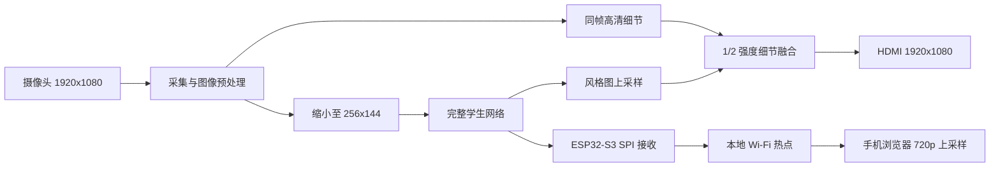
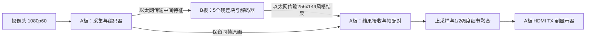

# 系统结构

### 单板：一块 FPGA 完成整个视频主链

原画帧、计算结果和显示数据通过帧号关联；只有完整结果写回后才交给显示模块。神经网络、存储调度、按键和显示由 RTL 控制。

### 双板：用网线分担神经网络计算

两块板型号相同，分别运行 A、B 固件。**板间使用以太网网线，显示器接 A 板 HDMI TX。**当前机械布局将 A 板放在上层，因此屏幕 HDMI 线从上层板引出。

A 板完成编码器，B 板完成全部五个残差块和解码器，再将结果发回 A。传输的是网络中间特征及结果，不是用网线传送完整 1080p HDMI 视频。

## 分辨率与帧率分开记录

| 环节 | 单板 | 双板以太网 |
|---|---|---|
| 采集与HDMI尺寸 | 1920×1080 | 1920×1080 |
| CNN输入和输出 | 256×144 | 256×144 |
| 新风格结果 | 约30张/秒                     | 约60张/秒                     |
| 手机画布 | 1280×720，由256×144风格图放大 | 1280×720，由256×144风格图放大 |

完整状态见[使用与构建](build_and_use.md)和[性能说明](performance/README.md)。
